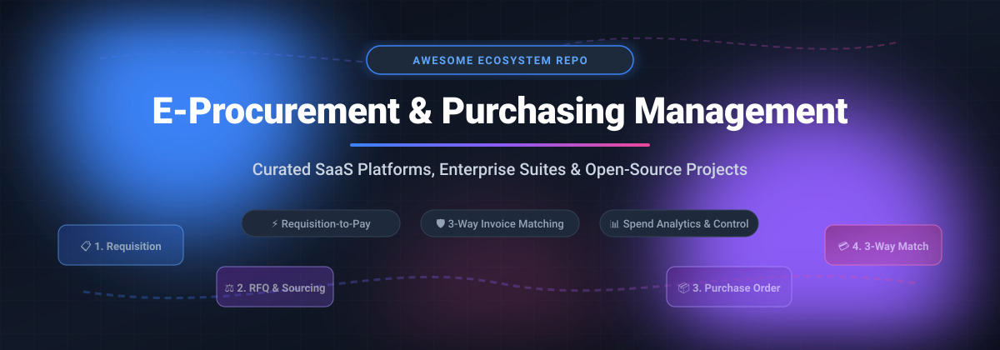

  

# 🛒 Awesome E-Procurement & Purchasing Management

  
  
  
  
  
  

> 🌟 **A curated directory of top SaaS platforms, cloud software, and open-source GitHub projects for E-Procurement, Requisition-to-Pay (R2P/P2P) automation, supplier lifecycle management, 3-way invoice matching, and enterprise spend control.**

---

## 📑 Table of Contents

- [📈 Sector Overview & Market Dynamics](#-sector-overview--market-dynamics)
- [☁️ SaaS / Hosted Platforms](#️-saas--hosted-platforms)
- [💻 Open-Source GitHub Projects](#-open-source-github-projects)
- [🤝 How to Contribute](#-how-to-contribute)
- [💖 Support](#-support)
- [⭐ Star History](#-star-history)
- [⚖️ Disclaimer](#️-disclaimer)

---

## 📈 Sector Overview & Market Dynamics

The global procurement and e-procurement software market is valued at approximately **$8.6B to $10.7B** and is projected to expand toward **$18B to $28B** over the next decade at a compound annual growth rate (CAGR) of **8% to 10.5%**, accelerated by AI-assisted spend intelligence, supplier risk management, and mandatory digital e-invoicing compliance. Structurally, the industry exhibits a **consolidated core at the enterprise tier**—dominated by top-tier incumbents (SAP Ariba, Coupa, Jaggaer, Ivalua) operating in an oligopolistic setting—underpinned by a **heavily fragmented long tail** of mid-market innovators, agile P2P startups, and self-hosted open-source software targeting budget-conscious organizations seeking complete data sovereignty.

---

## ☁️ SaaS / Hosted Platforms

Below is a breakdown of prominent commercial e-procurement, business spend management (BSM), and contract lifecycle management (CLM) platforms, sorted in descending order by company scale (market capitalization, enterprise valuation, or annual revenue).

| 🏢 Product | 📊 Company Scale (Valuation / Revenue) | 🏷️ Pricing (Starting Tier) | 🎁 Free Tier / Free Trial Limits | 🔍 Description |
|:---|:---|:---|:---|:---|
| **[SAP Ariba](https://www.sap.com/)** | **~$260B – $287B** *(SAP SE Market Cap)* | **$2,400 / month** *(Base configuration; full enterprise suite starts ~$80k–$300k/year)* | **No free tier for buyers** *(Suppliers get free Ariba Network Standard Account for unlimited basic PO/invoicing; buyers can access self-guided interactive tour & temporary 14-day BTP planning trial)* | Enterprise-scale Source-to-Pay (S2P) and supplier network powering global business commerce, contract compliance, catalog buying, and ERP integrations. |
| **[Coupa](https://www.coupa.com/)** | **$8.0B** *(Enterprise Valuation at Thoma Bravo acquisition)* | **$1,250 / month** *($15,000 / year base entry; mid-market commonly $50k–$250k+/year)* | **No free tier & no free trial** *(Live custom demo and scoping session via enterprise sales team only; suppliers get free basic Coupa Supplier Portal registration)* | Flagship Business Spend Management (BSM) platform orchestrating requisitioning, expense tracking, AI-driven supply chain modeling (LLamasoft), and contract management. |
| **[Jaggaer](https://www.jaggaer.com/)** | **~$3.0B** *(Enterprise Valuation at Vista Equity acquisition)* | **$11,667 / month** *(~$140,000 / year starting annual contract)* | **No free tier & no free trial** *(Requires custom multi-year enterprise agreement; tailored guided product demo available through sales)* | Autonomous and direct/indirect procurement platform featuring AI-powered contract management, complex sourcing, and supplier lifecycle evaluation for large enterprises and higher ed. |
| **[Ivalua](https://www.ivalua.com/)** | **$1.1B** *(Peak Unicorn Valuation; ~$150M–$200M ARR)* | **$12,500 / month** *(~$150,000 / year starting contract floor)* | **No free tier & no free trial** *(Enterprise deployment only; guided interactive sandbox demo provided on-demand during vendor qualification)* | Unified Source-to-Pay suite designed for multinational corporations managing complex multi-tier supply networks, direct materials, and strict regulatory audit trails. |
| **[Procurify](https://www.procurify.com/)** | **~$80M–$100M+** *(Total VC Raised; ~$25M–$55M ARR)* | **$1,000 / month** *(Billed annually for base purchasing and approval workflows)* | **No free tier & no self-serve free trial** *(Personalized product walkthrough and tailored sandbox environment provided upon request)* | Modern, user-friendly spend management platform designed for mid-market businesses seeking rapid deployment, real-time budget tracking, and corporate card controls. |
| **[Precoro](https://precoro.com/)** | **~$14.8M** *(Estimated ARR; Bootstrapped)* | **$499 / month** *(Core Plan, billed annually for small-to-mid teams)* | **14-day free trial** *(Full access to core requisition, PO creation, 3-way matching, and approval workflows; no credit card required)* | Transparently priced Procure-to-Pay software enabling automated purchase requests, purchase orders, budget allocations, and seamless QuickBooks/Xero/NetSuite integrations. |
| **[Gatekeeper](https://www.gatekeeperhq.com/)** | **~$14M** *(Estimated ARR)* | **$875 / month** *(Essentials tier, billed annually with unlimited users)* | **7-day free trial** *(Available through assisted enterprise evaluation / Microsoft Marketplace; limits active vendor tracking to 150 third-party entities)* | Vendor and contract lifecycle management platform with AI-driven renewal alerts, automated supplier risk scoring, and unlimited user seats. |
| **[Tradogram](https://www.tradogram.com/)** | **~$1M** *(Estimated ARR; Bootstrapped)* | **$99 / month** *(Essentials Tier; Capterra listed $209/month multi-user starter)* | **Free-for-life tier capped at 1 user & 5 transactions/month** *(Paid plans also feature a 14-day risk-free trial)* | Cloud-based purchasing software providing budget tracking, requisition approvals, delivery receipts, and supplier contract monitoring with an accessible free entry tier. |

---

## 💻 Open-Source GitHub Projects

Curated list of self-hosted, open-source e-procurement solutions, ERP purchasing modules, and developer frameworks—sorted in descending order by GitHub star count.

| 📦 Project | ⭐ Star Badge | 📝 Description & Procurement Architecture |
|:---|:---|:---|
| **[Odoo Purchase](https://github.com/odoo/odoo/tree/master/addons/purchase)** |  | **Full requisition-to-pay automation within the Odoo ERP ecosystem.** Features: automated procurement proposals, RFQ dissemination, purchase orders, vendor evaluation, barcode-based receiving, and 3-way invoice matching with multiple costing methods (Standard, Average, FIFO). **Best for companies running or adopting Odoo.** |
| **[ERPNext Buying](https://github.com/frappe/erpnext)** |  | **Comprehensive open-source purchasing and procurement module in ERPNext.** Features: automated material requests, multi-supplier RFQ distributions, quotation comparison matrices, tiered purchase order approvals, automated 3-way matching, purchase receipts, and supplier scorecards. **Best for mid-to-large enterprises seeking a complete, customizable open-source ERP.** |
| **[Apache OFBiz](https://github.com/apache/ofbiz-framework)** |  | **Enterprise-grade open-source automation suite with mature purchasing and order management.** Features: complex requisition hierarchies, purchase orders, vendor catalog management, multi-currency pricing, and integration into Java-based supply chain backbones. **Best for large organizations requiring deep enterprise customization.** |
| **[OpenBoxes](https://github.com/openboxes/openboxes)** |  | **Open-source supply chain and inventory management software with purchase order tracking.** Features: PO generation, vendor catalogs, shipment milestone tracking, goods receiving, and requisition workflows built specifically for healthcare, humanitarian, and public sector supply networks. **Best for global health NGOs and distributed clinic supplies.** |
| **[Leihs](https://github.com/leihs/leihs)** |  | **Open-source equipment reservation, procurement, and asset lending platform.** Features: self-service user equipment requisitions, administrative order management, approval trees, inventory tracking, and lifecycle auditing for organizational gear. **Best for universities, media production centers, and enterprise asset lending.** |
| **[OpenProcurement API](https://github.com/openprocurement/openprocurement.api)** |  | **Open-source e-procurement core toolkit and tender management API powering national procurement platforms (such as ProZorro).** Features: transparent reverse auctions, multi-lot tender management, bid qualification pipelines, contract tracking, and Open Contracting Data Standard (OCDS) compliance. **Best for government and public sector e-tendering.** |
| **[WebERP](https://github.com/timschofield/webERP)** |  | **Lightweight open-source accounting and ERP system with complete purchasing workflows.** Built with PHP/MySQL. Includes sales and purchase order management, supplier accounts payable, goods received notes (GRN), multi-currency pricing, and role-based permissions. **Best for SMBs seeking a fast, zero-dependency ERP without heavy server requirements.** |
| **[Procuman Community Edition](https://github.com/procuman/procuman-community-edition)** |  | **Free e-procurement software built on top of EspoCRM.** Features: supplier profile management, centralized product catalogs with vendor associations, **automated purchase orders with tax calculation and PDF generation**, multi-language support, and REST API connectors. **Best for teams already utilizing EspoCRM or requiring dedicated PO creation.** |
| **[VendSync (BidFlow)](https://github.com/RavalMunjal/VendSync)** |  | **Full-stack procurement and vendor management reference architecture.** Features: independent vendor registration portal, RFQ authoring, multi-quote side-by-side comparison, approval workflows, auto-generated POs, and audit logs. Built on React, Node.js, and MongoDB. **Best for teams seeking a modern boilerplate for custom procurement portals.** |
| **[Shillinq](https://github.com/ConductionNL/shillinq)** |  | **Open-source procurement and business administration suite for Nextcloud.** Features: purchase order workflows, supplier management, approval chains, **PO revision control with diff tracking**, supplier qualification questionnaires, and contract spend dashboards. **Best for organizations operating on Nextcloud wanting integrated financial workflows.** |
| **[Nexus Procurement](https://github.com/azaharizaman/nexus-procurement)** |  | **Framework-agnostic procurement management engine for PHP and Laravel.** Features: purchase requisitions, PO creation, goods receipt notes (GRN), **sub-500ms 3-way matching engine for 100 lines**, vendor quotation comparisons, and strict segregation of duties (Requester ≠ Approver ≠ Receiver ≠ Payment Authorizer). **Best for developers building custom procurement applications.** |

---

## 🤝 How to Contribute

We welcome contributions from procurement professionals, developers, and open-source enthusiasts!

1. 🍴 **Fork** the repository.
2. 🌿 Create a new feature branch (`git checkout -b feature/add-new-procurement-tool`).
3. 📝 Update `README.md` following the tabular format (ensure pricing, free tier limits, company scale, and star badges are included).
4. 💾 Commit your changes (`git commit -m "Add NewProcurementTool with pricing and details"`).
5. 🚀 Push to your branch (`git push origin feature/add-new-procurement-tool`).
6. 📬 Submit a **Pull Request** detailing the merits of the added platform.

---

## 💖 Support

If you find this curated directory helpful for evaluating e-procurement solutions or architecting purchasing software, please consider supporting the project:

- ⭐ **Star this repository** to improve discoverability.
- 🍴 **Fork and share** with fellow developers and finance/supply chain teams.
- ☕ **Buy me a coffee / Sponsor the project**: Support ongoing maintenance and curation on the [GitHub Sponsor Dashboard](https://github.com/sponsors/ishandutta2007).

---

## ⭐ Star History

---

## ⚖️ Disclaimer

- This repository is a **community-curated index** compiled for informational and educational purposes; inclusion does not constitute an endorsement.
- Procurement systems handle mission-critical financial workflows (banking details, PO authorization, supplier master data). Always enforce segregation of duties, budget validation gates, and cryptographic audit logs to mitigate payment fraud.
- Enterprise SaaS pricing and open-source project roadmaps evolve continuously. Always verify the latest pricing schedules and software licenses with the respective vendors before deploying to production environments.

---

  <b>Built with ❤️ for procurement officers, finance leaders, and engineers building the future of purchasing systems.</b>

